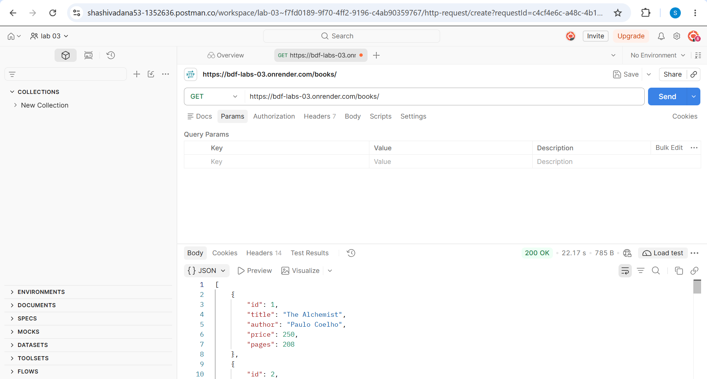
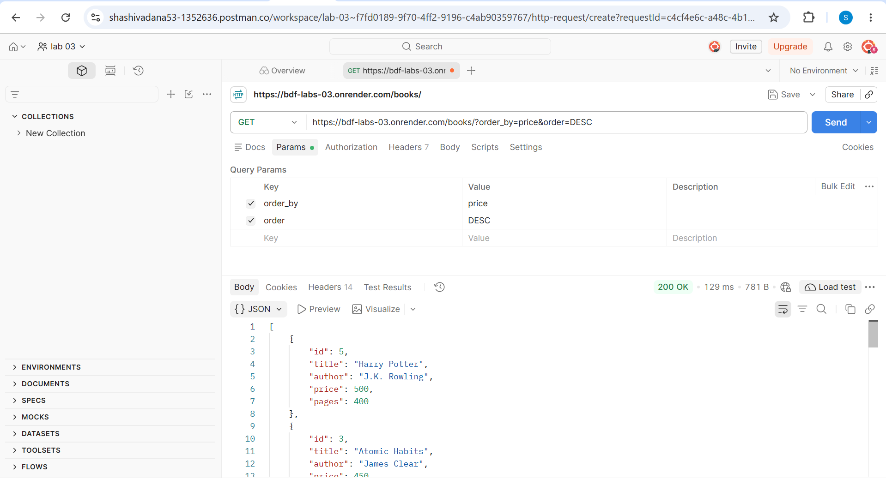
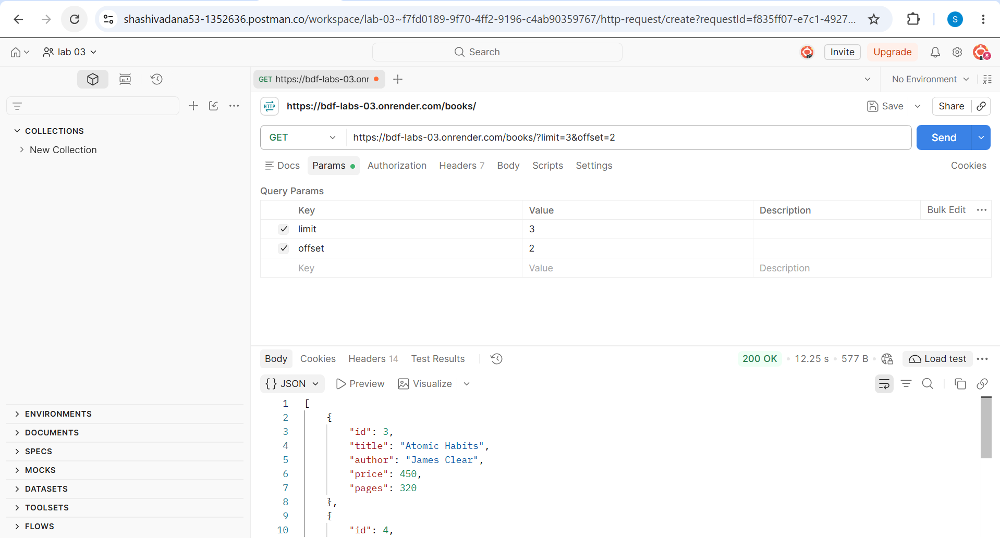
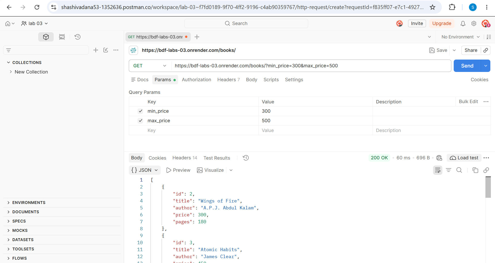
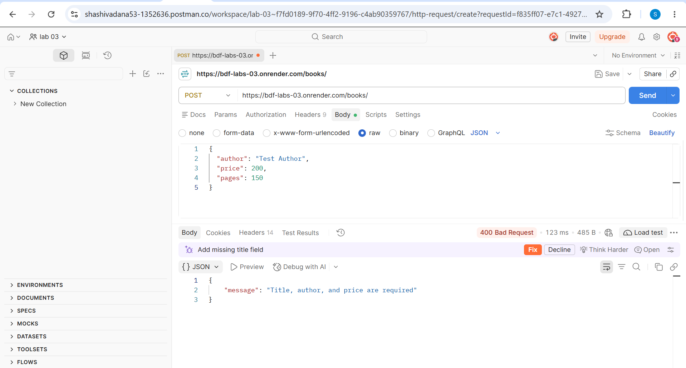
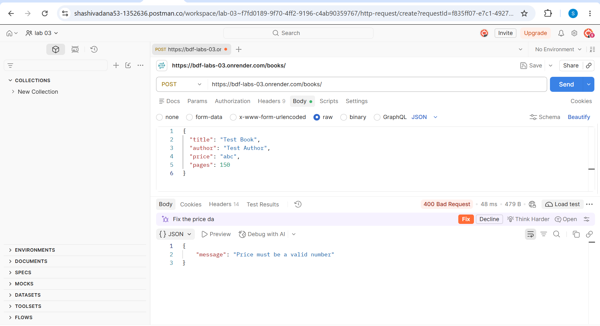
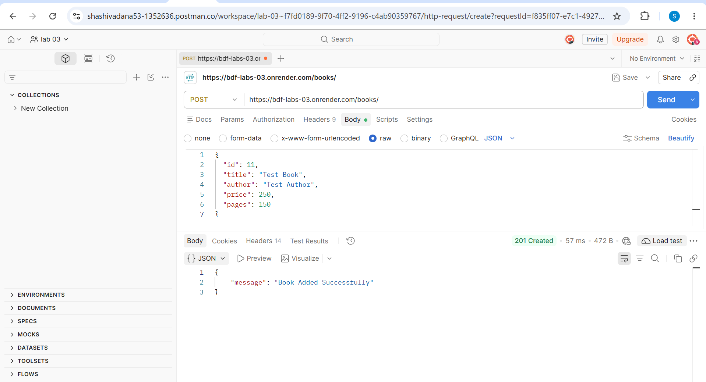
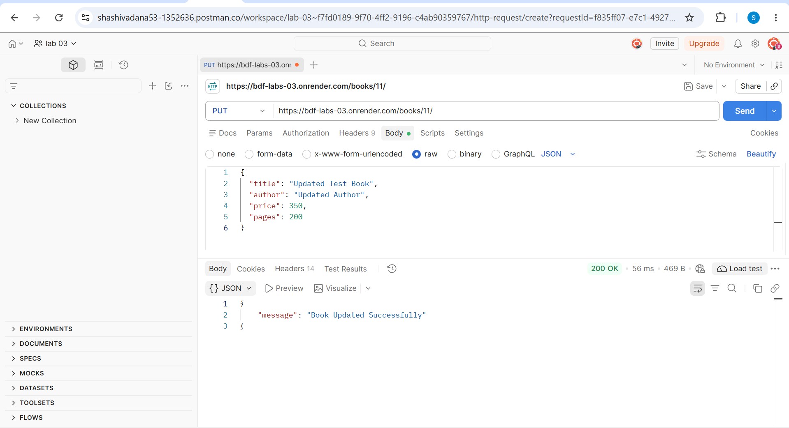
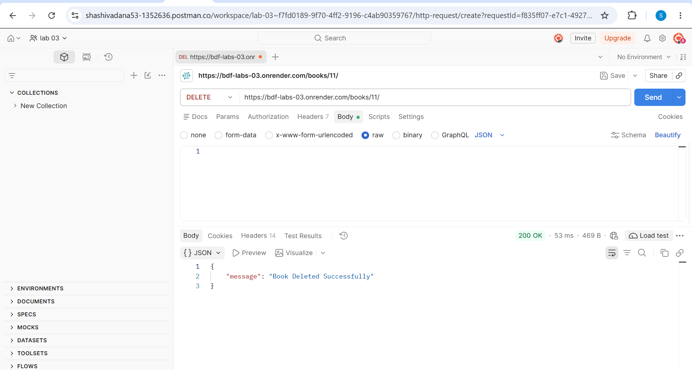

# Lab 3: REST API, Query Parameters, Validation and Debugging

**Name:** Narahari Shashivadana  
**Registration Number:** 252U1R7066  
**Section:** CSE(FSD)-2B 309

## Live Deployment

https://bdf-labs-03.onrender.com/books/

## Project Description

This project implements a REST API using Node.js, Express.js and SQLite. It supports book management operations, searching, sorting, pagination, price filtering and input validation.

## Technologies Used

- Node.js
- Express.js
- SQLite
- Postman
- Render

## Installation and Running

1. Clone the repository.
2. Install dependencies:

```bash
npm install
```

3. Start the server:

```bash
npm start
```

The server runs on port 3000 by default.

## API Endpoints

| Method | Endpoint | Description |
|---|---|---|
| GET | `/books/` | Get all books with search, sorting and filters |
| GET | `/books/:bookId/` | Get a book by ID |
| POST | `/books/` | Add a new book with validation |
| PUT | `/books/:bookId/` | Update book details |
| DELETE | `/books/:bookId/` | Delete a book |

## Query Parameters

- `search_q` – Search books by title.
- `order_by` – Sort by a selected column.
- `order` – Sort in ASC or DESC order.
- `limit` – Set the number of results.
- `offset` – Skip a selected number of results.
- `min_price` – Minimum book price.
- `max_price` – Maximum book price.

## Validation and Status Codes

- 200 – Successful GET, PUT and DELETE.
- 201 – Book created successfully.
- 400 – Invalid or missing input.
- 404 – Book not found.

## Debugging Exercises

1. Fixed port conflict (`EADDRINUSE`).
2. Corrected wrong import path.
3. Fixed table-name typo (`no such table`).
4. Added missing `await` for asynchronous database operations.

## Screenshots

### 1. Get All Books


### 2. Search Books


### 3. Sort Books


### 4. Limit and Offset


### 5. Price Range


### 6. Missing Title Validation


### 7. Missing Author Validation


### 8. Invalid Price Validation


### 9. Create Book


### 10. Update Book


### 11. Delete Book


### 12. Not Found Error


## Problems Faced and Solutions

- Resolved SQLite installation and deployment issues.
- Corrected API validation errors.
- Tested different HTTP methods and status codes.
- Practised debugging common errors.
