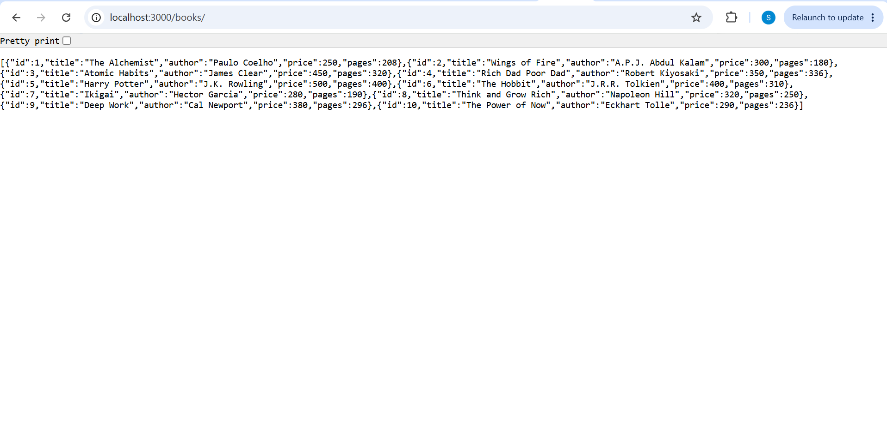
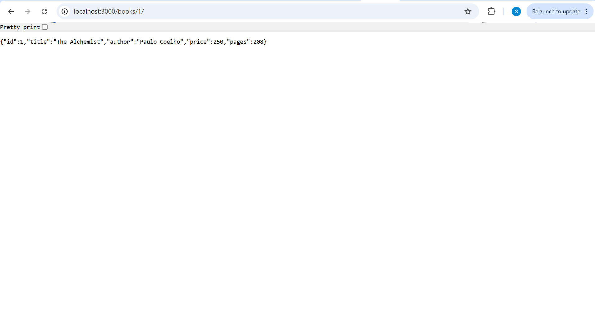
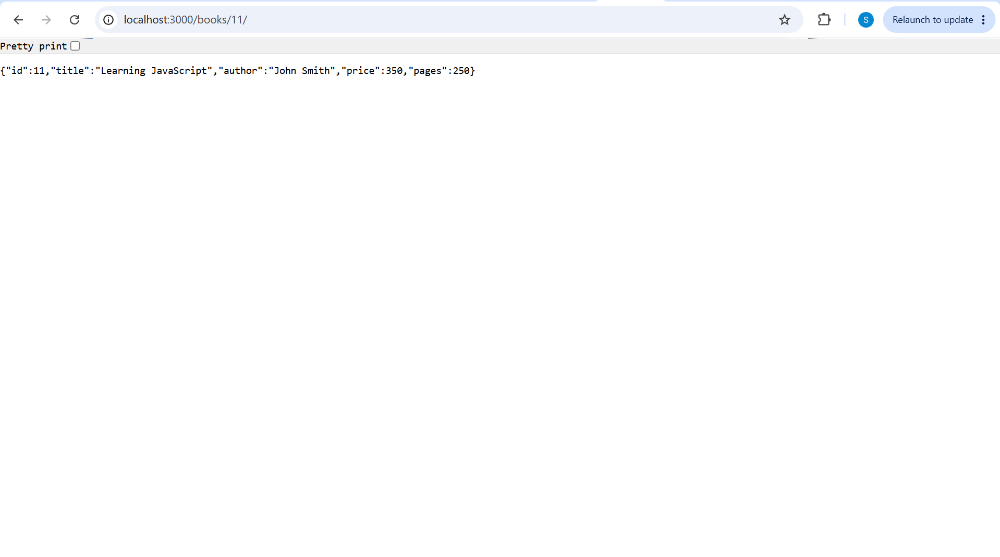
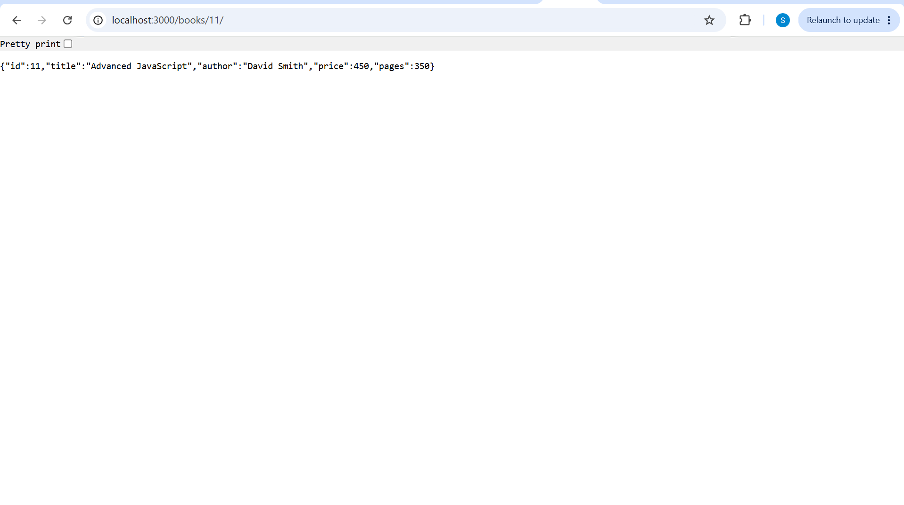
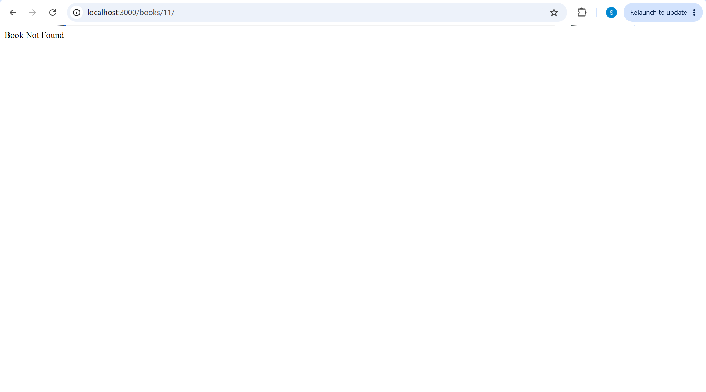

# Lab 2: SQLite database and CRUD routes

## Student Details

- **Name:** Shashi Vadana
- **Registration Number:** 252U1R7066
- **Section:** CSE-FSD-2B 309
- **Course:** Backend Development Fundamentals
- **Lab Number:** 02

## Live Link

**Status:** 

The application currently runs locally at `http://localhost:3000`. It has not been deployed to a public hosting platform yet.

## Objective

To connect an Express.js server to a SQLite database and implement CRUD operations through HTTP routes. The application allows users to retrieve, add, update, and delete book records.

## Technologies Used

- Node.js
- Express.js
- SQLite
- `sqlite`
- `sqlite3`
- Nodemon

## Database Details

- **Database file:** `books.db`
- **Table name:** `book`

The `book` table contains the following columns:

| Column | Data Type | Description |
|---|---|---|
| id | INTEGER PRIMARY KEY | Unique ID of the book |
| title | TEXT | Title of the book |
| author | TEXT | Author of the book |
| price | INTEGER | Price of the book |
| pages | INTEGER | Number of pages |

The database was initialized with 10 book records using the SQLite CLI.

## Installation and Setup

### Prerequisites

- Node.js and npm
- SQLite CLI

### Steps to Run the Project

1. Clone or download this repository.
2. Open the `lab-02` folder in the terminal.
3. Install the dependencies:

   ```bash
   npm install
   ```

4. Start the development server using Nodemon:

   ```bash
   npm run dev
   ```

5. The server runs locally at:

   `http://localhost:3000`

### Environment Variables

No environment variables are required for the current local setup. The server uses port `3000` by default and supports the `PORT` environment variable.

## API Endpoints

| HTTP Method | Endpoint | Description |
|---|---|---|
| GET | `/books/` | Retrieves all books from the database. |
| GET | `/books/:bookId/` | Retrieves a book using its ID. |
| POST | `/books/` | Adds a new book to the database. |
| PUT | `/books/:bookId/` | Updates an existing book using its ID. |
| DELETE | `/books/:bookId/` | Deletes a book using its ID. |

## Screenshots

The following screenshots show the API testing results.

### 1. GET All Books

Retrieves all book records from the database.



### 2. GET Book by ID

Retrieves the details of a specific book.



### 3. POST a New Book

Adds a new book to the database.



### 4. PUT Update a Book

Updates the details of an existing book.



### 5. DELETE a Book

Deletes an existing book from the database.



## Testing

All five API endpoints were tested locally.

- GET requests successfully retrieved book records.
- POST successfully added a new book.
- PUT successfully updated the book details.
- DELETE successfully removed the book.

The database was also checked using the SQLite CLI and the browser for GET requests.

## Problems Faced and Solutions

### 1. Connecting to the Local API

**Problem:** Postman Web's Cloud Agent could not send requests to `localhost`.

**Solution:** Used PowerShell to send POST, PUT, and DELETE requests and used the browser to verify GET responses.

### 2. Opening the SQLite Database File

**Problem:** Windows could not open the `.db` file directly because no application was associated with it.

**Solution:** Used the SQLite CLI to inspect and verify the database records.

## Notes

- SQL queries use parameter placeholders (`?`) for user-supplied values.
- The database connection is established before the Express server starts.
- The `node_modules` folder and `.env` files are excluded using `.gitignore`.
- The SQLite database file is included in the repository.

